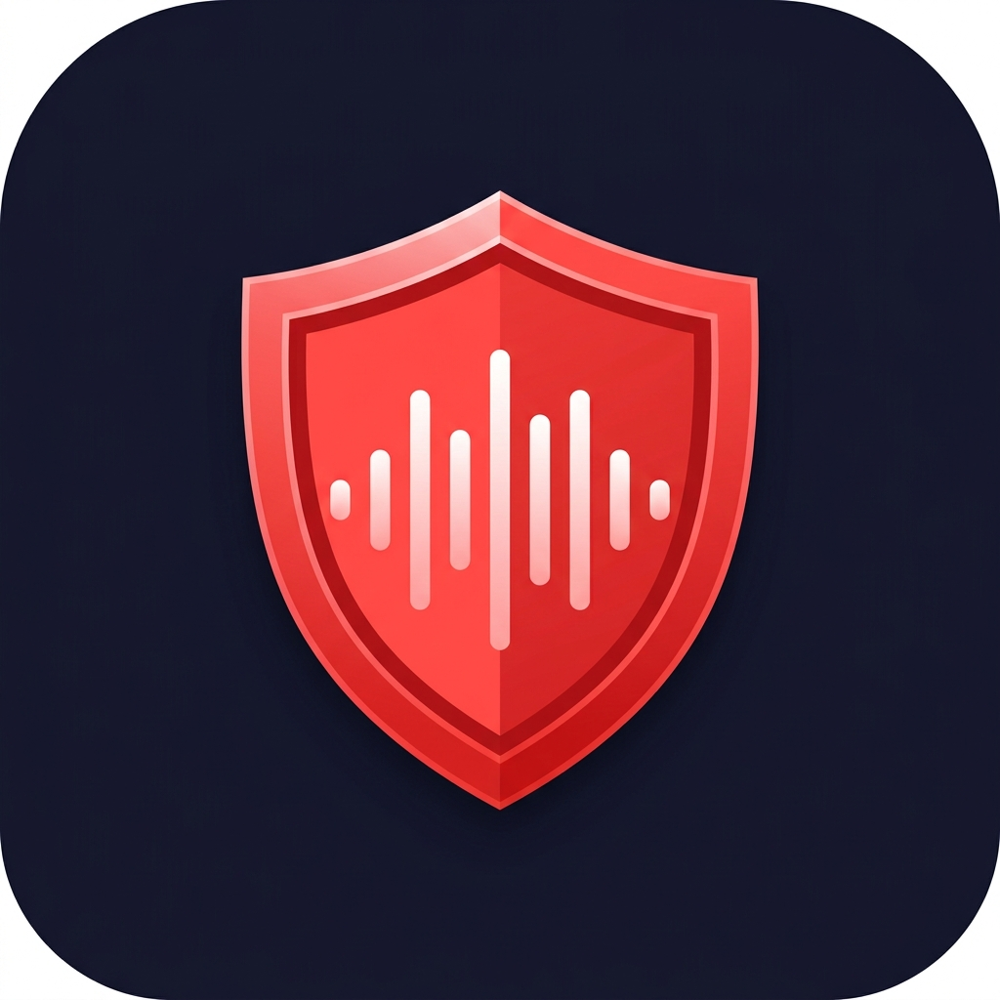
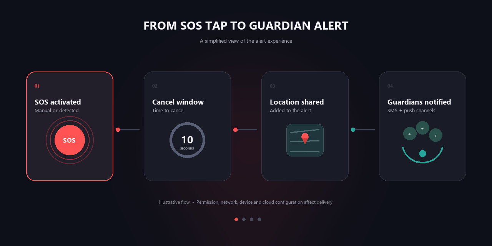
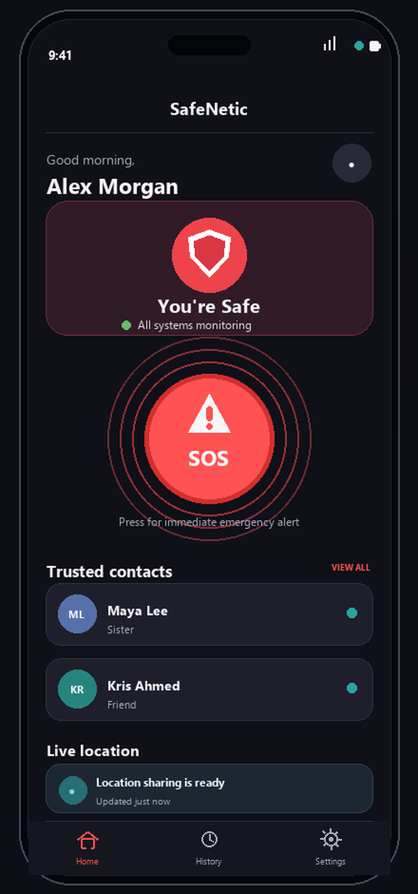
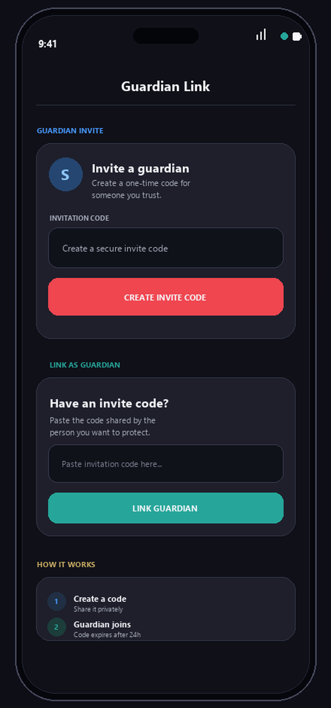
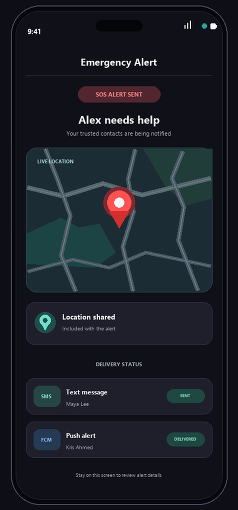

<div align="center">
  
  <h1>SafeNetic</h1>
  <p><strong>Personal safety, with your trusted people close by.</strong></p>
  <p>A Flutter Android app for SOS alerts, trusted guardian links, location sharing, and on-device fall and distress detection.</p>
  <p>
    
    
    
  </p>
</div>

<div align="center">
  
</div>

## What SafeNetic does

SafeNetic brings a manual emergency alert and automatic safety signals into one mobile app. A person can add trusted contacts, share a time-limited invite with a guardian, and send an alert with their current location. The app also includes on-device motion and distress-sound detection, with an optional Bluetooth wearable connection.

> **Preview note:** The screens below are illustrative mockups based on the current app UI. Names, locations, and delivery statuses are sample data; these are not screenshots captured from a running device.

## App previews

<table>
  <tr>
    <td align="center" width="33%">
      
      <br /><strong>Safety dashboard</strong>
    </td>
    <td align="center" width="33%">
      
      <br /><strong>Guardian linking</strong>
    </td>
    <td align="center" width="33%">
      
      <br /><strong>Alert status</strong>
    </td>
  </tr>
</table>

## Features

- **Manual SOS:** Start an emergency alert from the dashboard, with a configurable cancel countdown.
- **Automatic alerts:** Detect unusual motion and distress sounds on the device; the countdown can be cancelled if help is not needed.
- **Trusted guardians:** Create a one-time guardian invite that expires after 24 hours, or join using a code shared with you.
- **Location sharing:** Include current coordinates in an emergency event and show the alert location on a map.
- **Multiple alert channels:** Send guardian push notifications through Firebase Cloud Messaging and SMS through Android. If SMS permission is unavailable, the app can open the SMS app with a prepared message.
- **Alert history and status:** Review saved alert events and the delivery receipt reported by the notification services.
- **Optional wearable support:** Pair a compatible Bluetooth device to provide additional motion data.

## How it is built

| Area | Implementation |
| --- | --- |
| Mobile app | Flutter and Dart; Android is the primary target |
| Sign-in and data | Firebase Authentication and Cloud Firestore |
| Push delivery | Firebase Cloud Functions and Firebase Cloud Messaging |
| Motion and sound | On-device TensorFlow Lite models, with fallback detection paths |
| Location and maps | Device location services and Google Maps for Flutter |
| SMS | Android native SMS support, with a system SMS-app fallback |
| Optional alert fallback | Authenticated FastAPI service in `backend/` |

The SOS flow is designed so that alert events are recorded in Firestore and Cloud Functions handle the primary push-notification path. The Android app also sends SMS to configured guardians. An HTTPS backend fallback is included for eligible primary-delivery failures; configure and deploy it for your environment if you use that path.

## Run the Android app

### Requirements

- Flutter SDK with Dart 3 support
- Android Studio or Android SDK tools
- A Firebase project with Authentication, Cloud Firestore, and Cloud Messaging configured
- A restricted Google Maps API key for the Android app
- Node.js 22 and Firebase CLI, if you are deploying the Functions and Firestore rules

### Setup

1. Clone this repository and fetch Flutter packages:

   ```bash
   git clone https://github.com/Sawaid-hub/safenetic_app.git
   cd safenetic_app
   flutter pub get
   ```

2. Register an Android app in your Firebase project. Replace the project-specific `android/app/google-services.json` and update the Firebase client options in `lib/firebase_option.dart` for your own project. Use your own Firebase project for local development.

3. Provide the Maps key to the Android build. Add this line to `android/local.properties`:

   ```properties
   GOOGLE_MAPS_API_KEY=your_restricted_android_maps_key
   ```

   The Gradle build also reads `GOOGLE_MAPS_API_KEY` from the environment. Restrict the key to the Android app identity and the required Maps APIs, and keep it out of commits.

4. Select the Firebase project for the command-line tools and deploy the versioned Firestore rules and Cloud Functions when you are ready:

   ```bash
   firebase login
   firebase use --add
   cd functions
   npm ci
   cd ..
   firebase deploy --only firestore:rules,functions
   ```

5. Start the Android app on a connected device or emulator:

   ```bash
   flutter run
   ```

The project also contains a FastAPI alert fallback under `backend/`. It is optional for local UI development, but must be deployed and configured if the app is expected to use that fallback.

## Security and configuration

Firebase client API keys identify an app and are included in mobile app configuration; they are not administrator credentials. Protect Firebase data with Authentication, restrictive Firestore rules, API restrictions, and App Check where configured. Never add service-account JSON files, private keys, unrestricted Maps keys, or backend secrets to the app or repository.

Before production use, review [SECURITY_CHECKS.md](SECURITY_CHECKS.md) for the remaining project-console actions and deployment checks. Review key restrictions and rotation, verify deployed Firestore rules and Functions, and test alert delivery on real devices. App Check is not yet integrated into the Flutter client; add and verify client support before enforcing it in Firebase. The app requires device permissions, connectivity, and correctly configured Firebase services; emergency detection or delivery can fail and should not replace local emergency services.

## Repository map

```text
lib/                  Flutter app, screens, models, and services
assets/models/        On-device motion and sound models
functions/            Firebase Cloud Functions
backend/              Optional authenticated FastAPI alert fallback
firestore.rules       Firestore access rules
docs/readme/          README illustrations and animation
SECURITY_CHECKS.md    Security review and deployment checklist
```

## Contributing

Issues and focused pull requests are welcome. Please describe the device and Android version for mobile bugs, and never include real personal data, location traces, access tokens, or credentials in reports.
